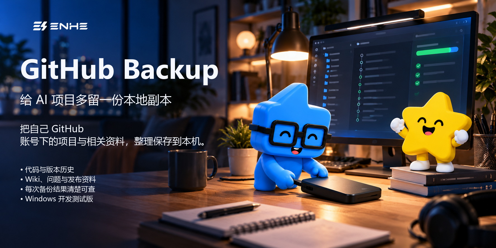

# GitHub Backup｜给 AI 项目多留一份本地副本

[简体中文](README.md) | [English](README.en.md)

> **AI 帮你做出的项目，别让唯一一份只留在 GitHub。** 趁账号还能登录，把自己有权限的项目和资料备份到电脑。如果账号被停用或暂时无法登录，提前留下的本地副本能降低项目取不回来的风险。
>
> [查看可下载版本](https://github.com/yangjing6213-dev/GitHub-Backup/releases) · [开始备份](#开始备份) · [使用前请了解](#使用前请了解)
>
> **请提前备份：** 账号已经无法访问后，这个工具不能帮你解封账号，也不能取回从未备份的内容。

## 这个工具做什么？

GitHub Backup 是一个 Windows 桌面工具。登录你自己的 GitHub 账号后，它会把你有权限访问的仓库和支持的项目资料保存到电脑。它不需要 AI 模型，也不是下载任意 GitHub 链接的工具。

默认只备份你自己拥有的仓库；你可以明确选择有权限访问的组织或协作者仓库。备份保存在本地，不会由桌面程序自动上传回 GitHub。

## 备份会保存什么？

| 内容 | 说明 |
| --- | --- |
| 项目代码与版本历史 | 包含仓库使用的 Git LFS 大文件对象。 |
| 项目资料 | 支持保存 Wiki、仓库信息、问题、合并请求、评论、标签、里程碑和发布信息。 |
| 发布附件 | 选择“完整备份”时下载；“日常备份”用于更新代码和资料。 |
| Actions 记录 | 可选保存工作流运行日志和构建附件；受 GitHub 保留期限和每个仓库的容量上限影响。 |
| 备份结果 | 每次运行都会留下结果摘要和日志；遇到 GitHub 限流时可暂停并保存续接进度。 |

备份完成后，还可以验证并恢复到一个新的本地文件夹、把副本校验后复制到另一个本地位置，或设置每日/每周计划。定时计划会在应用打开时检查是否到期；应用关闭时它不会在后台运行。

## 开始备份

1. 打开[项目发布页](https://github.com/yangjing6213-dev/GitHub-Backup/releases)，查看版本说明，下载对应的 Windows x64 安装包和 SHA-256 校验值。发布页可能同时保留旧测试包；不要把 `Source code` 源码压缩包当作可运行程序。
2. 运行安装包并打开应用。当前 v5 安装包尚未签名，Windows 可能显示“未知发布者”；请先核对文件来源和校验值，不要关闭系统保护。安装和卸载请按发布说明操作。
3. 填写你自己的 GitHub 用户名，选择本机固定磁盘上的备份文件夹，然后按应用提示检查 Git、GitHub CLI 和 Git LFS。缺少工具时，应用会显示可用的安装或官方说明。
4. 阅读登录提示并通过浏览器登录。先选“日常备份”或“完整备份”，开始后等应用显示结果，再查看摘要和日志；不要只凭文件夹已经出现就判断成功。

运行前需要 Windows x64 电脑、自己的 GitHub 账号、可用网络和足够的本地磁盘空间。当前安装只在开发机 Windows 11 25H2 x64 上核验过，其他系统版本尚未确认兼容；主程序自带 .NET 运行环境。备份会处理所选账号范围内的多个仓库，而不是只处理一个项目。

## 使用前请了解

- **这是预览版。** v5 安装包已通过文件检查并在开发机完成旧版卸载和新版安装；源代码自动检查也已通过。但干净电脑安装、其他电脑运行、真实账号下的权限差异和完整备份恢复尚未验证。请勿把预览版当作重要资料的唯一副本。
- **发布包可能早于当前源码。** 本页介绍的是当前仓库中的项目状态；下载前请以对应 Release 的版本说明、附件名称和 SHA-256 为准，确认其中包含你需要的功能。
- **登录可能影响同一 Windows 用户的其他 GitHub CLI 工具。** 浏览器登录会使用 GitHub CLI 的共享凭据库；如果你在其他工具中登录了不同账号，请先留意这一点。
- **本地备份可能包含私密内容。** 代码、提交历史和项目资料会按原样保存，不会加密。保护好电脑和备份磁盘，也不要把原始备份或未经检查的诊断文件公开分享。
- **它不是 GitHub 全站导出。** 没有权限或未选中的仓库不会被备份；子模块不会递归抓取；Actions 资料需手动开启且会受期限和容量限制。恢复只会生成新的本地工作目录，不会写回 GitHub。
- **第二份本地副本仍在你选择的位置。** 如果两份副本都在同一台电脑或同一块磁盘上，设备或磁盘损坏仍可能同时影响它们。

## 常见问题

**如果账号已经无法登录，还能用它取回项目吗？** 不能。工具只能整理你仍有权限读取、并且在账号失去访问前保存下来的资料。

**自动备份会在电脑关机时运行吗？** 不会。每日/每周计划会在你打开应用时检查是否到期，不是常驻的 Windows 后台任务。

**这个工具会收费调用 AI 吗？** 不会调用付费 AI 模型。你仍需要自行提供网络、GitHub 账号和本地存储空间。

**这个项目用什么许可证？** 本项目原创源代码使用 [MIT 许可证](LICENSE)。它不替代第三方组件各自的许可证，也不授予第三方商标或作者介绍图片的使用权。

## 项目资料

- [安装包验证记录](docs/verification/setup-installer.md)
- [开发者构建说明](publish/README.md)
- [完整许可证](LICENSE)

## 关于作者

Enhe（恩禾）｜产品设计师 · 一人公司实践者 · AI Builder

用 AI 打造一人公司。

- GitHub：[yangjing6213-dev](https://github.com/yangjing6213-dev)
- X / Twitter：[Amenenhe_ai](https://x.com/Amenenhe_ai)
- 网站：[恩禾 ENHE AI](https://www.enhe-tech.com.cn/)
- 微信：Hu-Amen
- 邮箱：[amen.enhe@gmail.com](mailto:amen.enhe@gmail.com)
