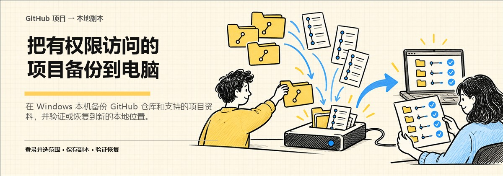
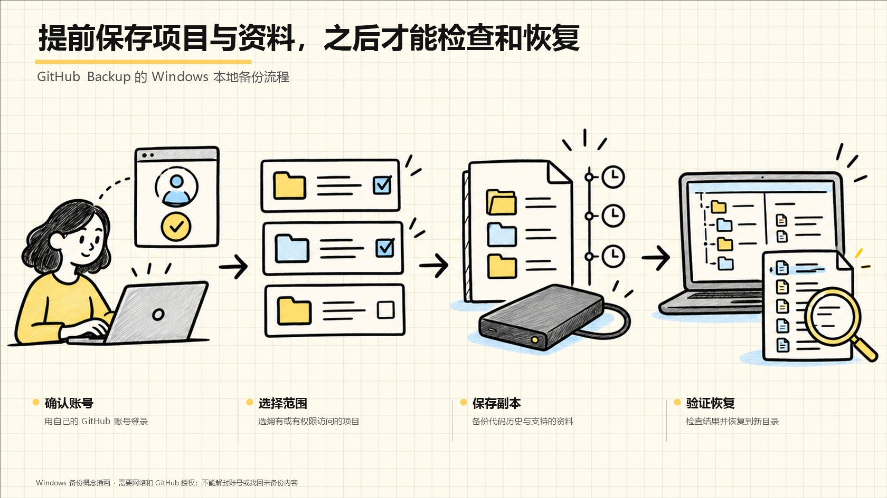

# GitHub Backup｜给 AI 项目多留一份本地副本

> 在 Windows 本机备份你有权限访问的 GitHub 仓库和支持的资料，并验证或恢复到新的本地位置。

   [-yellowgreen?style=flat-square)](LICENSE)

[简体中文](README.md) · [English README](README.en.md) · [English cover](assets/portfolio-promo-2026-11-02/cover-en.jpg) · [English overview](assets/portfolio-promo-2026-11-02/overview-en.jpg)

如果 GitHub 账号暂时无法访问，提前留在本机的仓库副本可能帮你保住代码和历史。本工具面向 Windows，会按权限与选择备份 GitHub 项目资料；它不能解封账号，也无法取回从未备份的内容。

[安装与备份](#六安装与快速开始) · [常见问题](#十注意事项与常见问题) · [版本说明](#十一版本说明)

## 一、这个项目是什么？

GitHub Backup 是一个 Windows x64 桌面工具。登录你自己的 GitHub 账号后，它会把你有权限访问并选择的仓库及支持的项目资料保存到本地。它不需要 AI 模型，也不是任意 GitHub 链接下载器。

## 二、先看效果

> AI 概念插画：说明“选择仓库—保存副本—检查—恢复”的过程，不是实际软件界面或真实账号备份截图。

输入是你选择的 GitHub 账号、仓库范围和本地备份位置；运行后检查应用结果摘要与日志，再按需验证或恢复到新的本地文件夹。

## 三、适合谁用？

### 特别适合
- 希望给自己的 GitHub 项目留一份本地副本的 Windows 用户。
- 想保存代码历史以及部分 Wiki、问题、PR、评论、发布或 Actions 资料的项目维护者。

### 不适合
- 需要解封账号、恢复从未备份内容或访问无权查看仓库的人。
- 希望把本地文件自动加密上传到云端的人。
- 需要在 macOS/Linux 使用或依赖关机后后台备份的人。

## 四、你会得到什么？

本地 Git 仓库副本和所选的项目资料；代码历史可包含 Git LFS 对象。完整备份可下载发布附件，日常备份用于更新代码和资料。每次运行会生成结果摘要和日志；恢复操作会新建本地目录，不会写回 GitHub。

## 五、它能帮你解决什么问题？

只把项目放在 GitHub，容易把账号访问、网络和平台状态当成唯一入口。提前在本机保存副本，能让你继续查看代码和历史，也能在需要时恢复到新的工作目录。

备份仍需要你选择范围、检查结果并保护本地磁盘。两份副本如果都在同一台电脑或同一块磁盘上，设备损坏仍可能同时影响它们。

## 六、安装与快速开始

需要 Windows x64 电脑、自己的 GitHub 账号、网络和足够的本地磁盘空间。安装包自带 .NET 运行环境；应用会按提示检查 Git、GitHub CLI 与 Git LFS。备份不调用付费 AI 模型，网络和存储由你自行提供。

1. 打开[项目 Releases](https://github.com/yangjing6213-dev/GitHub-Backup/releases)，查看版本说明，下载 Windows x64 安装包及 SHA-256 校验值。
2. 核对文件来源和校验值，再运行安装包。当前 v5 安装包尚未签名，Windows 可能显示未知发布者；不要为此关闭系统保护。
3. 打开应用，填写自己的 GitHub 用户名，选择固定磁盘上的备份目录，并按提示检查本机依赖。
4. 阅读登录提示，通过浏览器登录后选择“日常备份”或“完整备份”。等待应用显示结果，再查看摘要和日志。

完成标准是应用显示备份结束，并且摘要与日志没有未处理错误；仅看到文件夹出现不足以判断备份完整。安装验证见 [记录](docs/verification/setup-installer.md)。

## 七、如何使用？

首次使用可以选择少量仓库先做日常备份，核对结果与本地目录后再扩大范围。需要较完整资料时再选择完整备份，并留意 Actions 记录的保留期限和每个仓库容量上限。

恢复时先验证备份，再恢复到新的本地文件夹；不要把原始备份公开分享。计划任务会在应用打开时检查是否到期，应用关闭时不会作为后台服务运行。

## 八、项目工作流程

选择账号与授权范围 → 选择备份类型和本地目录 → 检查 Git 等依赖 → 登录 GitHub → 运行备份 → 查看摘要、日志和校验结果 → 需要时恢复到新目录。

账号认证和仓库权限由 GitHub 管理；工具处理本地备份流程，你负责选择范围和保管副本。

## 九、项目目录结构

- <code>docs/verification/</code>：安装验证记录。
- <code>publish/</code>：开发者构建说明。
- 本地备份目录：由你在应用中选择，不会默认上传到 GitHub。

应用设置的具体保存位置与发布包版本有关，首次运行时以应用提示和版本说明为准。

## 十、注意事项与常见问题

- **账号已经无法登录还能备份吗？** 不能。它只能读取当前账号仍可访问的内容。
- **电脑关机时会自动备份吗？** 不会。计划会在应用打开时检查是否到期。
- **备份内容会加密吗？** README 未说明本地备份加密；应按敏感项目文件保护设备和磁盘。
- **会备份所有 GitHub 内容吗？** 不会。只处理你有权限且选择的仓库；子模块不递归抓取，Actions 资料可选且受保留期限和容量限制。
- **可以恢复到 GitHub 吗？** 恢复会创建新的本地工作目录，不会写回 GitHub。
- **许可证范围是什么？** [MIT License](LICENSE) 仅适用于原创源代码；第三方组件和作者图片不因此取得授权。

[MIT License](LICENSE) 仅适用于本项目原创源代码；第三方组件和作者图片不因此取得授权。

## 十一、版本说明

当前说明称 v5 安装包为预览版，并列出了尚未完成的跨电脑、真实账号权限差异及完整恢复验证。下载前请以 [Releases](https://github.com/yangjing6213-dev/GitHub-Backup/releases) 的版本说明、附件和校验值为准。

## 十二、相关项目

- [GitHub 开源项目安全发布 Skill](https://github.com/yangjing6213-dev/github-oss-release-skill)：帮助 AI 先审查发布证据与范围；适合在备份后整理仓库时使用。

## 十三、关于作者

**Enhe（恩禾）｜产品设计师 · 一人公司实践者 · AI Builder**

用 AI 打造一人公司。

- GitHub：[yangjing6213-dev](https://github.com/yangjing6213-dev)
- X / Twitter：[Amenenhe_ai](https://x.com/Amenenhe_ai)
- 网站：[恩禾 ENHE AI](https://www.enhe-tech.com.cn/)
- 微信：Hu-Amen
- 邮箱：[amen.enhe@gmail.com](mailto:amen.enhe@gmail.com)

## 十四、继续探索

我做这个工具是想给自己在 GitHub 上的项目多留一个可核对的本地入口。如果你也会用 AI 做项目、整理资料或搭建工作流，可以到 [恩禾 ENHE AI](https://www.enhe-tech.com.cn/) 看看更多个人实践。

